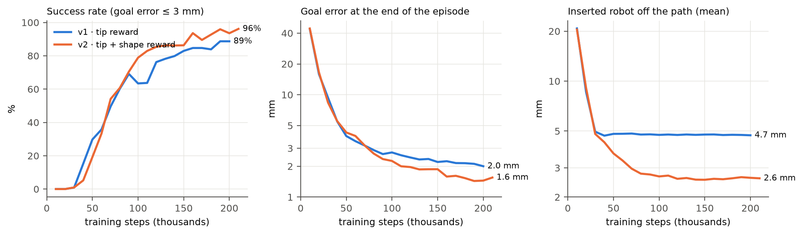

# Soft-Robot Ventricle Navigation with PPO (SOFA + Stable-Baselines3)

This repository is a tutorial project showing how to train a **deep reinforcement learning** policy
that steers a **pneumatic soft continuum robot** through the brain ventricles in a **SOFA** physics
simulation. The robot enters at **Kocher's point**, leaves a rigid sheath at the frontal horn of the
right lateral ventricle, and must reach a target **80 mm** along a planned path without leaving the
ventricle.

The notebook walks through the full pipeline:
- turning patient data (planned path, ventricle mesh, Kocher fiducials) into a simulation environment
- the **environment**, **observation** and **action** spaces (residual control on a nominal curvature schedule)
- the **reward function**, term by term, on recorded episodes
- the **policy** (actor-critic MLP), loaded and queried without the simulator
- **PPO training**: hyperparameters, learning curves, diagnostics
- **results**, comparing a tip-only reward (v1) with a tip + robot-body-shape reward (v2)

## Results

Patient 44, right lateral ventricle; 200k training steps per policy.

<table>
  <tr>
    <td valign="top">
      <table>
        <tr><th>Setting</th><th>Value</th></tr>
        <tr><td>Simulator</td><td>SOFA v26.06</td></tr>
        <tr><td>Algorithm</td><td>PPO, 5 parallel envs</td></tr>
        <tr><td>Training steps</td><td>200,000 (~1 h, 6 CPU cores)</td></tr>
        <tr><td>Test episodes</td><td>30 per policy</td></tr>
      </table>
    </td>
    <td valign="top">
      <table>
        <tr><th>Controller</th><th>Success</th><th>Goal error</th><th>Body off path</th></tr>
        <tr><td>Nominal schedule (no RL)</td><td>0%</td><td>45.4 mm</td><td>8.3 mm</td></tr>
        <tr><td>PPO v1: tip reward</td><td>90%</td><td>1.2 mm</td><td>4.6 mm</td></tr>
        <tr><td>PPO v2: tip + shape reward</td><td><b>97%</b></td><td><b>0.7 mm</b></td><td><b>2.5 mm</b></td></tr>
      </table>
    </td>
  </tr>
</table>

Success means the robot is fully inserted with a goal error of 3 mm or less. Goal error and body
deviation are for the deterministic policy. Adding the body-to-path term to the reward halved how far
the robot body strays from the path, and it also made the tip more accurate.

> **Note:** Results come from a single anatomy used for both training and testing, with a rigid wall
> model. They measure control quality, not generalisation to new patients.



## Quick start

```bash
pip install -r sofa_rl/requirements.txt
jupyter notebook SoftRobot_Ventricle_PPO.ipynb    # runs without SOFA, from the saved logs and models
python sofa_rl/app.py                            # Gradio demo: 3D replay, results, live SOFA runs
```

Retraining or running SOFA needs a SOFA v26.06 build; see [`sofa_rl/ENVIRONMENT.md`](sofa_rl/ENVIRONMENT.md).

## Repository

| Path | Contents |
|---|---|
| `SoftRobot_Ventricle_PPO.ipynb` | Tutorial notebook |
| `sofa_rl/` | Everything else: SOFA scene, Gymnasium environment, PPO training and evaluation (`rl/`), Gradio app, patient 44 data, results (logs, models, recorded episodes), figures, 2-page summary (`summary.pdf`), environment spec, video script |

## Data

The planned path, ventricle mesh and Kocher fiducials of one patient (patient 44, right side) come from
an MRI-derived dataset and are shared with the data owners' permission for reproducing this project.

## Built with

[SOFA](https://www.sofa-framework.org/) · [SofaPython3](https://github.com/sofa-framework/SofaPython3) ·
[Stable-Baselines3](https://github.com/DLR-RM/stable-baselines3) · [Gymnasium](https://gymnasium.farama.org/) ·
[PyTorch](https://pytorch.org/) · [Gradio](https://www.gradio.app/)
